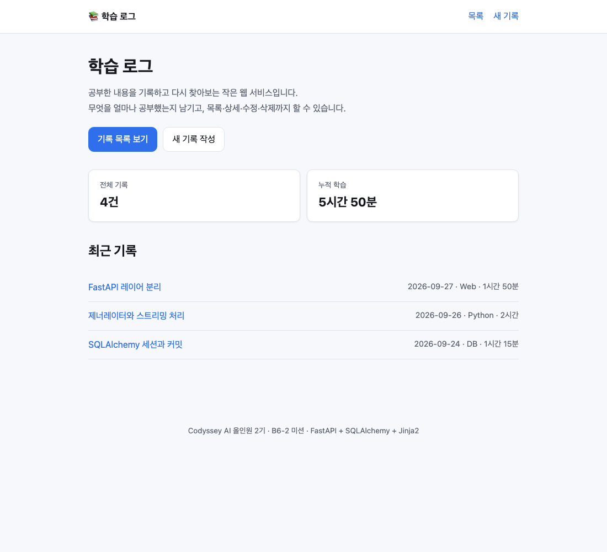
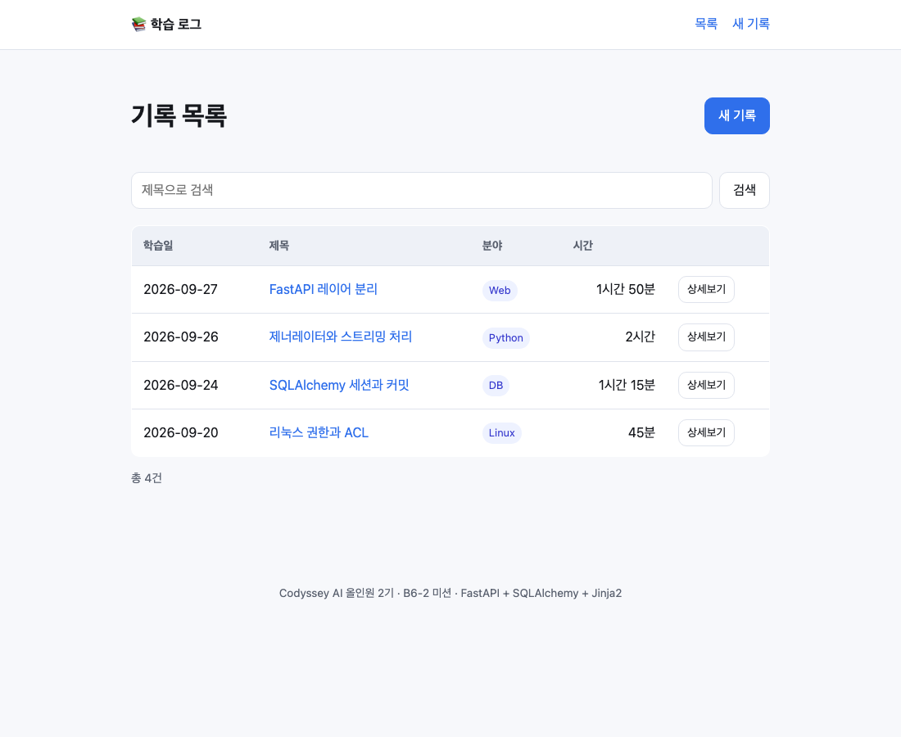
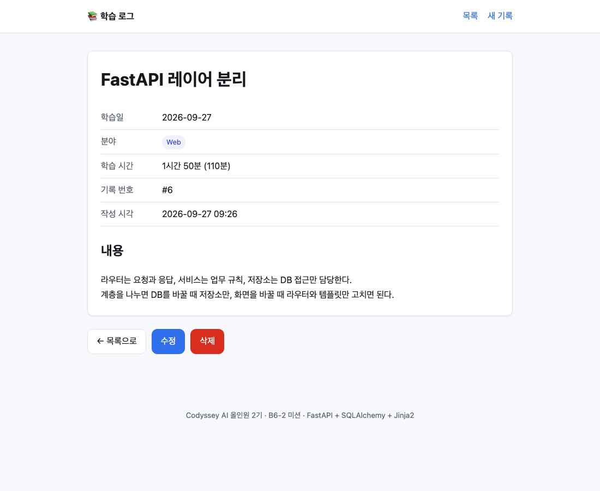
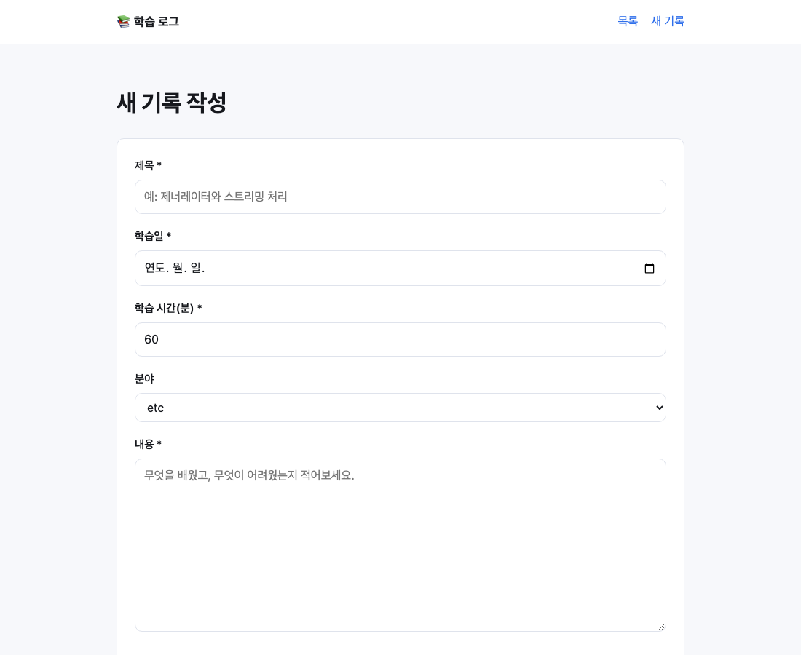
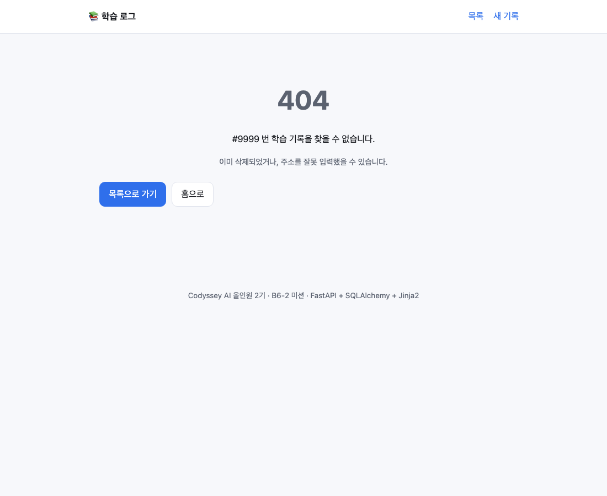

# 학습 로그 (Study Log)

> Codyssey AI 올인원 2기 · 본과정 AI·SW 기초 · **데이터베이스와 백엔드** 미션 (B6-2)
> FastAPI + SQLAlchemy + Jinja2 로 만든 게시판형 웹 서비스.
> 브라우저 요청이 **라우터 → 서비스 → 저장소 → 템플릿**을 거쳐 화면으로 돌아오는 전체 흐름을 직접 구현했습니다.

공부한 내용을 기록하고 목록·상세·수정·삭제할 수 있는 작은 웹 서비스입니다.

## 실행 방법

### 1. 가상환경 생성

```bash
cd study-log
python3 -m venv .venv
```

> Python **3.10 이상**이 필요합니다. (개발·검증 환경: 3.12.14)
> `python3 --version` 으로 먼저 확인하세요.

### 2. 가상환경 활성화

```bash
source .venv/bin/activate        # macOS / Linux
# .venv\Scripts\activate         # Windows
```

활성화되면 프롬프트 앞에 `(.venv)` 가 붙습니다.

### 3. 패키지 설치

```bash
pip install -r requirements.txt
```

설치되는 것은 과제가 지정한 5개뿐입니다: `fastapi`, `uvicorn`, `sqlalchemy`, `jinja2`, `python-multipart`

### 4. 서버 실행

```bash
uvicorn main:app --reload
```

터미널에 아래와 같이 나오면 정상입니다.

```
INFO:     Uvicorn running on http://127.0.0.1:8000 (Press CTRL+C to quit)
INFO:     Started reloader process [...]
INFO:     Application startup complete.
[startup] 데이터베이스 준비 완료 → http://localhost:8000
```

### 5. 접속

브라우저에서 **http://localhost:8000** 을 엽니다.
첫 실행 시 `database.db` 파일이 자동으로 생성됩니다.

> 가상환경을 빠져나올 때는 `deactivate`.

## 화면

| 화면 | 주소 | 설명 |
| --- | --- | --- |
| 홈 | `GET /` | 앱 설명 + 목록/등록 링크 + 통계 |
| 목록 | `GET /logs` | 최신순 목록, `?q=` 로 제목 검색 |
| 등록 폼 | `GET /logs/new` | 빈 폼 |
| 등록 처리 | `POST /logs` | 저장 후 **303** 리다이렉트 → 상세 |
| 상세 | `GET /logs/{id}` | 전체 필드 + 수정/삭제/목록 링크 |
| 수정 폼 | `GET /logs/{id}/edit` | 기존 값이 채워진 폼 |
| 수정 처리 | `POST /logs/{id}/edit` | 저장 후 **303** → 상세 |
| 삭제 처리 | `POST /logs/{id}/delete` | 삭제 후 **303** → 목록 |



| 목록 | 상세 |
| --- | --- |
|  |  |

| 등록/수정 폼 | 없는 데이터 |
| --- | --- |
|  |  |

## 프로젝트 구조

```
study-log/
├── main.py                 # 앱 조립 (라우터 등록, 정적 파일, 시작 시 테이블 생성)
├── database.py             # 엔진 · SessionLocal · Base · get_db(Depends)
├── templating.py           # Jinja2 설정 (순환 참조를 피하려고 분리)
├── form_errors.py          # Pydantic 검증 실패 → 한국어 안내 문구
│
├── models/                 # SQLAlchemy ORM 모델 (DB 테이블)
│   └── study_log.py
├── schemas/                # Pydantic 스키마 (계층 사이를 오가는 데이터 모양)
│   └── study_log.py
├── repositories/           # 데이터 접근 (SELECT/INSERT/UPDATE/DELETE)
│   └── study_log.py
├── services/               # 업무 규칙 (검증·변환·예외)
│   └── study_log.py
├── routers/                # 요청/응답 처리 (FastAPI Router)
│   ├── home.py
│   └── study_logs.py
│
├── templates/              # Jinja2 SSR 템플릿
│   ├── base.html           #   공통 뼈대 (상속)
│   ├── home.html  list.html  detail.html  form.html  not_found.html
├── static/style.css        # 직접 작성한 CSS (외부 프레임워크 없음)
├── requirements.txt
└── database.db             # 실행하면 생성됨 (.gitignore 로 제외)
```

### 계층별 책임

| 계층 | 하는 일 | 하지 않는 일 |
| --- | --- | --- |
| **routers** | 요청에서 값 꺼내기, 화면/리다이렉트 반환 | 계산, DB 접근 |
| **services** | 업무 규칙 판단, ORM → DTO 변환 | HTTP, SQL |
| **repositories** | DB 읽기/쓰기 | 업무 판단 |
| **models** | 테이블 구조 정의 | 그 외 전부 |

각 계층은 **아래쪽만 압니다.** 그래서

- DB 를 SQLite → PostgreSQL 로 바꾸면 `database.py` 의 URL 만 바뀝니다
- REST API 로 바꾸면 `routers/` 만 새로 쓰고 services/repositories 는 그대로 씁니다
- `services.py` 에 `Request`/`Response` 가 하나도 없고, `routers/` 에 SQL 이 하나도 없는 것이 그 증거입니다

## 데이터 모델

`study_logs` 테이블, 단일 모델입니다. (과제 제약: 모델 간 연관관계는 다음 미션에서)

| 컬럼 | 타입 | 설명 |
| --- | --- | --- |
| `id` | Integer PK | 자동 증가 |
| `title` | String(100) | 제목 (2자 이상, 인덱스) |
| `content` | Text | 내용 |
| `studied_on` | Date | 학습일 (미래 불가, 인덱스) |
| `minutes` | Integer | 학습 시간(분), 1~1440 |
| `category` | String(30) | 분야 (Python/Web/Linux/DB/Algorithm/etc) |
| `created_at` | DateTime | 생성 시각 (DB가 채움) |

### 저장된 데이터 직접 확인하기

```bash
# 방법 1) 파이썬 스크립트
python -c "
import sqlite3
con = sqlite3.connect('database.db')
for row in con.execute('SELECT id, title, studied_on, minutes, category FROM study_logs'):
    print(row)
"

# 방법 2) DB Browser for SQLite 같은 GUI 도구로 database.db 열기
```

## 설계에서 신경 쓴 것

### 1. PRG(Post-Redirect-Get) — 새로고침해도 중복 등록되지 않는다

등록/수정/삭제 처리 후 **화면을 직접 그리지 않고** 리다이렉트를 돌려줍니다.

```python
return RedirectResponse(url=f"/logs/{log.id}", status_code=303)
```

그냥 화면을 그리면, 사용자가 F5 를 눌렀을 때 브라우저가 "POST 를 다시 보낼까요?"를 묻고
확인을 누르면 **같은 글이 또 등록됩니다.** 리다이렉트하면 주소창이 GET 주소로 바뀌므로
새로고침해도 GET 이 다시 갈 뿐입니다.

**왜 303 인가?**
302 는 재요청 시 원래 메서드를 유지해도 된다는 해석의 여지가 있어 일부 클라이언트가 POST 로 다시 보냅니다.
**303 See Other** 는 규격상 **반드시 GET 으로 바꿔서** 요청하라는 뜻이라 PRG 에 정확히 맞습니다.
(307/308 은 반대로 메서드를 유지하라는 뜻이므로 여기서 쓰면 안 됩니다.)

### 2. 폼 값이 처리되는 과정

```
브라우저 <form method="post">
   ↓  title=...&content=...  (application/x-www-form-urlencoded)
python-multipart 가 본문을 파싱
   ↓  전부 '문자열'
Form(default="") 매개변수에 꽂힘
   ↓
Pydantic 모델(StudyLogCreate)이 타입 변환 + 규칙 검사
   "2026-09-27" → date,  "90" → int,  제목 2자 이상, 미래 날짜 금지 ...
   ↓ 통과                        ↓ 실패
서비스 → 저장 → 303 리다이렉트    입력값을 유지한 폼을 400 과 함께 다시 렌더링
```

Form 매개변수를 전부 `str` 로 받는 이유는, `minutes: int = Form(...)` 로 선언하면
숫자가 아닐 때 FastAPI 가 **422 JSON 오류**를 내기 때문입니다. 사용자에게 보여줄 화면이 아닙니다.
문자열로 받아 직접 검증하면 실패 시 **입력값이 남아 있는 폼**을 다시 보여줄 수 있습니다.

### 3. ORM 모델을 화면에 직접 넘기지 않는다 (DTO 분리)

과제 권장사항입니다. 서비스가 ORM 객체를 `StudyLogRead`(Pydantic)로 바꿔서 돌려줍니다.

- ORM 객체는 **DB 세션에 묶여 있어** 세션이 닫힌 뒤 접근하면 문제가 생깁니다
- DB의 모든 컬럼을 화면이 볼 필요는 없습니다 (노출 범위를 스키마가 정합니다)

### 4. DB 세션은 요청 하나당 하나 (Depends)

```python
def get_db():
    db = SessionLocal()
    try:
        yield db          # 요청 처리 중 사용
    finally:
        db.close()        # 응답 후 반드시 닫힘
```

각 라우터가 직접 세션을 만들면 닫는 것을 깜빡하는 순간 연결이 새어나갑니다.
열고 닫는 책임을 한 곳에 모았고, 테스트 시 이 함수만 바꿔치기하면 테스트 DB로 갈아끼울 수 있습니다.

## 보너스 과제

| # | 과제 | 구현 | 위치 |
| --- | --- | --- | --- |
| 1 | 검색 기능 | ✅ | 목록의 `?q=` → `title.ilike('%키워드%')` |
| 2 | 검증 처리 | ✅ | Pydantic + `form_errors.py` 한국어 안내, 입력값 유지 |
| 3 | 수정/삭제 UX | ✅ | 상세에서 수정/삭제/목록 이동, 삭제 시 확인창 |

## 제약 사항 준수

- 의존성은 `fastapi`, `uvicorn`, `sqlalchemy`, `jinja2`, `python-multipart` **5개뿐**
- 라우터/서비스/저장소/모델 디렉터리 분리
- 템플릿은 전부 `templates/` 아래
- 모든 화면은 `TemplateResponse` 로 SSR 렌더링
- 로그인/권한, 모델 간 연관관계는 구현하지 않음 (다음 미션 범위)
- 메모리 저장이 아니라 SQLite + SQLAlchemy ORM 사용

## 참고: curl 로 테스트할 때

브라우저는 폼 값과 URL 을 자동으로 퍼센트 인코딩합니다. curl 로 한글을 보낼 때는
**반드시 인코딩 옵션을 쓰세요.** 안 그러면 한글이 깨지거나 요청이 거부됩니다.

```bash
# 등록
curl -X POST http://localhost:8000/logs \
  --data-urlencode "title=오늘 공부한 것" \
  --data-urlencode "content=내용" \
  --data-urlencode "studied_on=2026-09-27" \
  --data-urlencode "minutes=90" \
  --data-urlencode "category=Python"

# 검색
curl -G http://localhost:8000/logs --data-urlencode "q=제너레이터"
```
